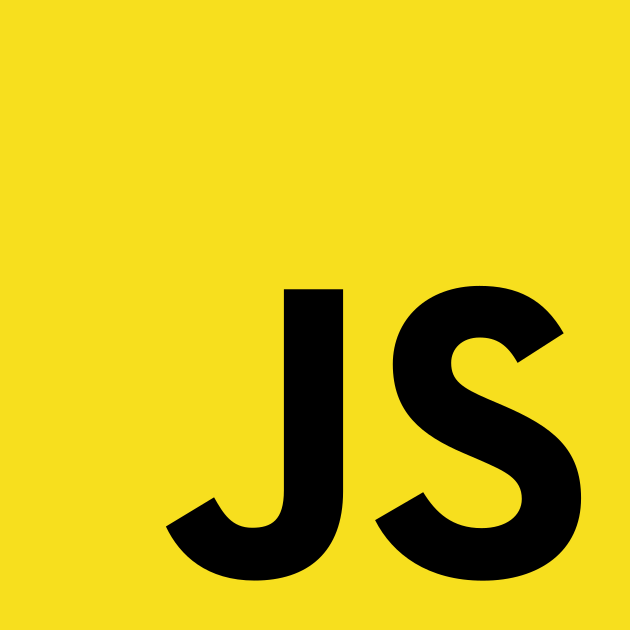

# Hi there! I'm Muhammad Razfaziya :wave:

[](https://github.com/VeonN4)
[](https://www.veonise.my.id)
[](https://wakatime.com/@22d3828d-610f-4f85-b24a-0d576a94c872)

I'm **Razfaziya**, a student at **SMKN 1 Cianjur**.

Currently interning as Full-Stack Developer at **Mobilus Interactive** for 3-months.

> [!IMPORTANT]
> Learn more about my journey [here](https://veonise.my.id "My personal website")...

<h2 align="left" id="tech">Tech</h2>

> Language I'm currently focused on

<table>
  <tr>
    <td align="center" width="96">
      <a href="#homepage">
        
      </a>
      <br>Python
    </td>
    <td align="center" width="96">
      <a href="#homepage">
        
      </a>
      <br>JavaScript
    </td>
  </tr>
</table>

> Things I use...

<table>
  <tr>
    <td align="center" width="96">
      <a href="#homepage">
        
      </a>
      <br>Windows
    </td>
    <td align="center" width="96">
      <a href="#homepage">
        
      </a>
      <br>VSCode
    </td>
  </tr>
</table>

## Playtime

<!--START_SECTION:waka-->


📊 **This Week I Spent My Time On** 

```text
🕑︎ Time Zone: Asia/Jakarta

💬 Programming Languages: 
TypeScript               3 hrs 56 mins       ████████████████░░░░░░░░░   64.16 % 
JSON                     52 mins             ████░░░░░░░░░░░░░░░░░░░░░   14.20 % 
Other                    29 mins             ██░░░░░░░░░░░░░░░░░░░░░░░   07.87 % 
Markdown                 27 mins             ██░░░░░░░░░░░░░░░░░░░░░░░   07.53 % 
TSConfig                 9 mins              █░░░░░░░░░░░░░░░░░░░░░░░░   02.47 % 

🔥 Editors: 
VS Code                  5 hrs 11 mins       █████████████████████░░░░   84.53 % 
OMP                      27 mins             ██░░░░░░░░░░░░░░░░░░░░░░░   07.56 % 
OpenCode                 21 mins             █░░░░░░░░░░░░░░░░░░░░░░░░   05.77 % 
Opencode Cli             7 mins              █░░░░░░░░░░░░░░░░░░░░░░░░   02.14 % 

🐱‍💻 Projects: 
coalition                6 hrs 8 mins        █████████████████████████   99.95 % 
web                      0 secs              ░░░░░░░░░░░░░░░░░░░░░░░░░   00.03 % 
admin                    0 secs              ░░░░░░░░░░░░░░░░░░░░░░░░░   00.02 % 
components               0 secs              ░░░░░░░░░░░░░░░░░░░░░░░░░   00.00 % 
backend                  0 secs              ░░░░░░░░░░░░░░░░░░░░░░░░░   00.00 % 

💻 Operating System: 
Windows                  6 hrs 8 mins        █████████████████████████   100.00 % 
```

🤖 **AI Coding This Week** 

```text
⏱ AI Coding Time: 3 hrs 47 mins (61.57%)

✍️ 938 lines written by AI, 378 lines written by hand (71.28% AI-written)

🔤 32,604,147 Input Tokens, 156,569 Output Tokens

💵 $73.33 Estimated AI Cost This Week

🧠 445 AI Sessions, 70 AI Prompts

GLM                      407 lines           ███████████░░░░░░░░░░░░░░   43.39 % 
Gemini                   337 lines           █████████░░░░░░░░░░░░░░░░   35.93 % 
OMP                      110 lines           ███░░░░░░░░░░░░░░░░░░░░░░   11.73 % 
Vscode                   42 lines            █░░░░░░░░░░░░░░░░░░░░░░░░   04.48 % 
Spark                    30 lines            █░░░░░░░░░░░░░░░░░░░░░░░░   03.20 % 

🔎 AI Coding Insights:
🤖 AI-Driven — 71.28% of written lines came from AI
📝 Concise Prompter — average 87 characters per prompt
🎯 One-Shot Prompter — average 0 prompts per session
🚀 High AI Trust — 42.31% of changed lines were hand-edited
```

**I Mostly Code in TypeScript** 

```text
TypeScript               14 repos            ████████░░░░░░░░░░░░░░░░░   32.56 % 
Blade                    4 repos             ██░░░░░░░░░░░░░░░░░░░░░░░   09.30 % 
PHP                      4 repos             ██░░░░░░░░░░░░░░░░░░░░░░░   09.30 % 
Dart                     3 repos             ██░░░░░░░░░░░░░░░░░░░░░░░   06.98 % 
Astro                    1 repo              █░░░░░░░░░░░░░░░░░░░░░░░░   02.33 % 
```


 Last Updated on 31/10/2026 21:46:04 UTC
<!--END_SECTION:waka-->

---

> _I'm way too lazy to make this good._
